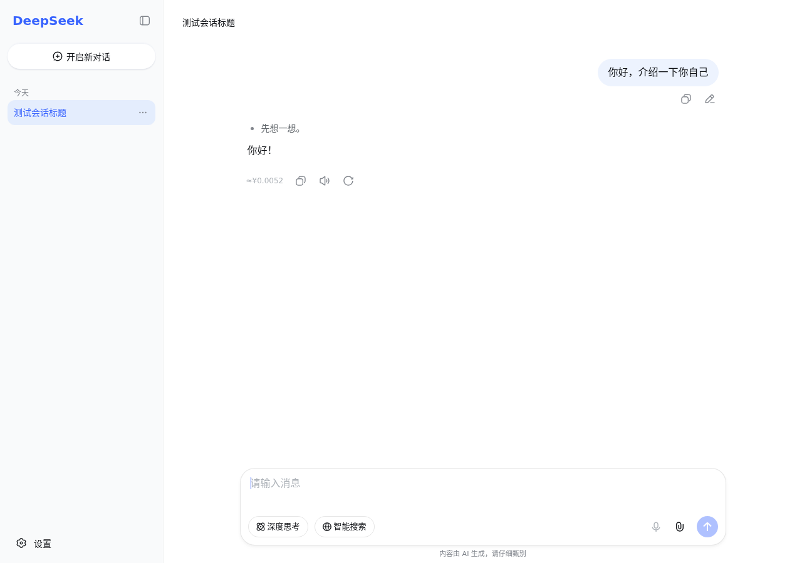
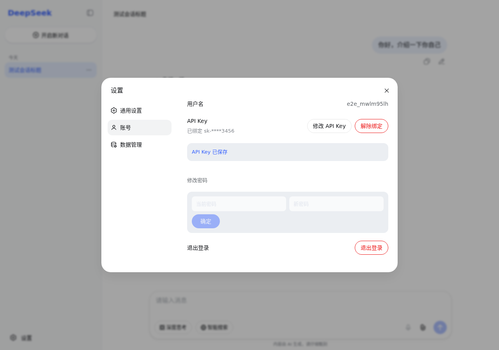

# DeepSeek 私有网页版（自建 Chatbot）

把 [DeepSeek 官方演示客户端 chat-demo](https://github.com/deepseek-ai/chat-demo) 改造成**多账号、多端共享、Docker 一键部署**的私有网页版：

- 复刻网页端界面与能力：深度思考、智能搜索（联网 + 边想边搜）、阅读链接、文件/图片上传、语音输入、朗读回答、消息分支（编辑 / 重新生成 / 继续生成）、Markdown / 公式 / Mermaid、中英双语、深浅色主题、**ZIP 历史对话导入导出**
- **账号密码登录**，历史对话、附件原件都存在服务端，换设备登录同一账号即可看到全部历史
- **API Key 绑定在账号下**（服务端加密保存，浏览器永远拿不到明文），也支持「服务器一个 Key 给多人共用」
- **去掉了「模型内容安全」**：请求里不再携带 `safety_check`，服务端代理还会兜底删除该参数
- 每条回答下方显示**本次 token 费用估算**（单价可通过 `PRICING_JSON` 调整）
- 全部运行在 Docker 里，宿主机只需要 Docker，不用装 Node / pnpm

> 数据默认落在 `./data`：SQLite（会话、账号、附件 BLOB、API Key 密文）+ 自动生成的 `app-secret`。备份 = 拷走这个目录。

## 界面预览

| 登录 | 对话（含思考、引用、费用） | 账号与 API Key |
|---|---|---|
|  |  |  |

截图来自容器内的自动化冒烟测试（mock 模型回复），更多截图见 [`docs/screenshots`](docs/screenshots)。

---

## 一、快速开始

```bash
# 1. 可选：准备配置（不配置也能跑）
cp .env.example .env
# 编辑 .env，至少可以设置 DEFAULT_DEEPSEEK_API_KEY 让所有人共用一个 Key

# 2. 构建并启动
docker compose up -d --build

# 3. 打开 http://localhost:3080，注册第一个账号
```

### 国内网络加速

- **npm 依赖**：构建时默认使用国内 npmmirror（淘宝）源，无需额外配置；海外环境可在 `.env` 里改 `NPM_REGISTRY=https://registry.npmjs.org`。
- **基础镜像**：默认 `node:24-bookworm-slim`。Docker Hub 拉取慢时，二选一：
  1. 在 Docker Desktop / daemon 里配好 registry mirror（推荐，一次配置全局生效）；
  2. 在 `.env` 里指定国内镜像仓库的同名镜像，例如
     `NODE_IMAGE=docker.m.daocloud.io/library/node:24-bookworm-slim`（或公司/云厂商提供的镜像地址）。
- 依赖层使用了 BuildKit 缓存挂载，重复构建时不会再重新下载 npm 包。

查看状态与日志：

```bash
docker compose ps
docker compose logs -f
```

停止 / 升级：

```bash
docker compose down          # 停止（数据保留在 ./data）
docker compose up -d --build # 重新构建升级
```

服务器上对外开放前，建议放在 Nginx / Caddy 后面加 HTTPS，并把 `COOKIE_SECURE=true`、`TRUST_PROXY=true` 写进 `.env`。

---

## 二、API Key 的三种用法

| 方式 | 配置 | 说明 |
|---|---|---|
| 每人绑定自己的 Key | 不配 `DEFAULT_DEEPSEEK_API_KEY` | 登录后在 **设置 → 账号** 里粘贴自己的 Key；服务端先用 `/models` 校验，再用 AES-256-GCM 加密存库。只有密文，浏览器只拿到 `sk-****abcd` 掩码。 |
| 一个 Key 全站共用 | `.env` 里设 `DEFAULT_DEEPSEEK_API_KEY=sk-...` | 账号没有绑定自己的 Key 时自动使用服务器默认 Key。适合「一个人付费、几个人一起用」。 |
| 混合 | 以上都配 | 默认用服务器 Key；某个账号在设置里绑了自己的 Key，就优先用他自己的。 |

所有对 DeepSeek 的请求都经过后端代理（`/api/ds/*`），由服务端注入 Key 并转发；密钥不会出现在前端代码、localStorage 或浏览器网络请求里。

---

## 三、账号与注册

- 注册 / 登录：用户名 + 密码（密码用 scrypt 加盐哈希）
- 登录态：HttpOnly + SameSite=Lax Cookie，默认 30 天（`SESSION_DAYS`）
- 关闭注册：`ALLOW_REGISTRATION=false`（已有账号仍可登录）
- 邀请码：`REGISTER_INVITE_CODE=xxx`，只有知道邀请码的人能注册（适合只给熟人用）
- 修改密码：设置 → 账号 → 修改密码；改完其他设备上的登录态失效
- 退出登录：设置 → 账号 → 退出登录（会清空本机缓存的对话数据）

> 账号没有「管理员后台」。几个人的小圈子使用够用；如果被陌生人注册，建议直接设邀请码或关闭注册后重建容器。

---

## 四、多端共享与同步

- 会话列表、每条消息、消息分支、附件原件全部存在服务端
- 登录后自动拉取；页面**切回前台 / 重新获得焦点**时会刷新列表与当前会话（生成中或有未保存修改时跳过，避免覆盖本地状态）
- 同一个账号在手机、电脑上可同时登录，互不踢下线
- 冲突策略：同一条会话两端同时改，以最后一次保存为准（个人使用场景足够）

---

## 五、历史对话导入 / 导出（ZIP）

设置 → 数据管理：

- **导出所有历史对话**：下载 ZIP，包含全部会话，以及服务端存有的图片原件；其他附件只保留文件信息（不含 API Key）
- **导入历史对话**：选择 ZIP 后**覆盖当前账号的全部对话**。支持：
  - 本应用导出的 ZIP（可以拿来在朋友之间分享、搬家）
  - **DeepSeek 网页端导出的历史对话 ZIP**（想从免费版迁过来时直接用这个）
- 导入是原子的：全部校验通过才替换；失败只清空暂存区，原对话不受影响

---

## 六、已实现 vs 未实现

| 网页端能力 | 状态 |
|---|---|
| 深度思考 / 智能搜索 / 阅读链接 / 引用角标 / 搜索卡片 | ✅（`deepseek-flash`，Anthropic 兼容 Messages API） |
| 文件、图片上传（PDF/Word/PPT/图片等，Files API） | ✅ |
| 朗读回答（TTS）、语音输入（ASR） | ✅ 通过后端代理 |
| 编辑消息、重新生成、继续生成、消息分支切换 | ✅ |
| 自动会话标题、重命名、删除 | ✅ |
| Markdown、代码高亮、KaTeX、Mermaid | ✅ |
| 中英双语、深浅色、移动端布局、位置信息 | ✅ |
| 账号密码登录、多端同步、账号级 API Key | ✅（本改造新增） |
| ZIP 导入导出、DeepSeek 网页端历史迁移 | ✅ |
| 每轮费用估算 | ✅ 估算值，仅供参考 |
| **模型内容安全（safety_check）** | ❌ 已按要求移除（服务端代理也会删除该参数） |
| 分享对话链接（公开 URL） | ❌ 未做；用 ZIP 导出/导入替代 |
| 多用户实时协作、团队空间 | ❌ 未做；每个账号数据隔离 |

> 合规提醒：本项目面向自用/熟人小范围使用。若对外提供服务，请自行承担内容安全审核、大模型登记、AI 标识等义务（DeepSeek 文档中的「模型内容安全」指引已在本项目中移除）。

---

## 七、目录结构

```
.
├── Dockerfile               # 多阶段构建：pnpm 构建前端 → 安装后端依赖 → 运行时镜像
├── docker-compose.yml       # 生产用：单容器 + ./data 数据卷 + 健康检查
├── docker-compose.test.yml  # 联调用：mock DeepSeek API，不产生真实费用
├── .env.example
├── web/                     # 前端（基于 deepseek-ai/chat-demo，MIT）
│   └── src/
│       ├── components/auth/         # 登录 / 注册页
│       ├── components/settings/     # 设置：通用 / 账号 / 数据管理
│       └── services/
│           ├── auth.ts              # 登录态、账号、API Key 绑定
│           ├── pricing.ts           # 费用估算
│           ├── api/backend.ts       # 自建后端请求封装
│           └── chat/db.ts           # 会话/附件存储（改为走服务端 API）
├── server/                  # 后端（Node 24 + Express + node:sqlite，无原生依赖）
│   ├── index.js             # 应用组装、静态文件、启动
│   ├── auth.js              # 注册/登录/退出/改密（scrypt + Cookie 会话）
│   ├── account.js           # API Key 绑定（校验 + 加密存储）
│   ├── storage.js           # 会话/附件/导入暂存 接口
│   ├── proxy.js             # DeepSeek API 反向代理（流式、注入 Key、删 safety_check）
│   ├── db.js                # SQLite 数据层
│   └── test/                # node:test 端到端测试 + mock 上游
└── tools/e2e/smoke.mjs      # 可选：容器内 headless Chromium 冒烟测试
```

---

## 八、数据备份与迁移

- 全部状态在 `./data`：
  - `data/app.db`（SQLite 主库，含账号、会话 JSON、附件 BLOB）
  - `data/app.db-wal` / `-shm`（WAL 文件）
  - `data/app-secret`（未配置 `APP_SECRET` 时自动生成的加密密钥）
- 备份：`docker compose stop && tar -czf backup.tar.gz data && docker compose start`
- 迁移到新机器：拷走 `data/` 目录 + `docker-compose.yml`（如果设置过 `.env`，一起拷走；**换了 `APP_SECRET` 会导致已绑定的 API Key 无法解密，需要重新绑定**）
- 容器入口会以 root 修正 `/data` 的属主后降权到 `node` 运行，Linux 上首次启动也不需要手动改目录权限

---

## 九、开发与测试（同样全部在 Docker 内）

> 不需要在宿主机安装 Node、pnpm 或任何依赖。

```bash
# 后端端到端测试（mock DeepSeek API，不花钱）
docker build --target test -t deepseek-web-test .
docker run --rm deepseek-web-test

# 前端类型检查 / Lint（在镜像的构建阶段容器里跑）
docker build --target web -t dsw-web .
docker run --rm dsw-web pnpm type
docker run --rm dsw-web pnpm lint

# 本地联调：mock 上游 + 完整应用
docker compose -f docker-compose.test.yml up -d --build

# 可选：浏览器冒烟测试（登录、发消息、刷新恢复历史、绑定 Key、ZIP 导出/导入、退出重登，并截图）
docker build -t dsw-e2e tools/e2e
docker run --rm --network dpsk-self_default \
  -e TARGET_URL=http://deepseek-web-test:3080 \
  -v "$PWD/docs/screenshots:/shots" dsw-e2e
```

宿主机一个 Node / pnpm / Chromium 都不用装：上面这些命令只是调用 Docker。

### 已通过的验证

- 后端：11 项 `node:test` 端到端测试（注册登录、改密、跨账号隔离、会话 CRUD、附件上传下载与回收、导入原子替换、API Key 加密绑定、SSE 透传、`safety_check` 被删除、默认 Key 回落、CSRF 拦截）
- 前端：`tsc` 类型检查 + `oxlint` 零告警
- 浏览器（headless Chromium）：19 项检查全部通过——注册进入对话、流式回答、思考块、费用估算、刷新/换设备后历史恢复、绑定 Key 后刷新仍生效、ZIP 导出→导入覆盖、退出重登、控制台零报错

> 注意：`server/test/mock-server.mjs` 是常驻 mock 服务，测试命令已显式指定 `test/e2e.test.js`，避免 `node --test` 把它当测试文件加载导致进程不退出。

前端单独热更新（可选，仅开发时）：`docker compose` 里跑后端后，在 `web/` 目录用容器的 Node 跑 `pnpm dev`（`rspack serve` 监听 8090，并把 `/api` 代理到 3080）。日常使用不需要这一步。

---

## 十、配置项

| 环境变量 | 默认值 | 说明 |
|---|---|---|
| `PORT` | `3080` | 容器内监听端口（宿主端口在 compose 的 `ports` 改） |
| `DATA_DIR` | `/data` | 数据目录 |
| `DEEPSEEK_API_BASE` | `https://api.deepseek.com` | 上游地址；测试时指向 mock |
| `DEFAULT_DEEPSEEK_API_KEY` | 空 | 服务器默认 Key（账号未绑定时使用） |
| `APP_SECRET` | 自动生成 | 加密 API Key 用；生产建议显式设置并妥善保存 |
| `ALLOW_REGISTRATION` | `true` | 是否允许注册 |
| `REGISTER_INVITE_CODE` | 空 | 非空时注册必须填写 |
| `SESSION_DAYS` | `30` | 登录态有效天数 |
| `COOKIE_SECURE` | `false` | HTTPS 部署时设 `true` |
| `TRUST_PROXY` | `false` | 在反向代理后面时设 `true`（取真实 IP 用于限流） |
| `MAX_JSON_BYTES` | 48MB | 单条会话 JSON 上限 |
| `MAX_UPLOAD_BYTES` | 96MB | 单个附件原件上限 |
| `PRICING_JSON` | 官方价 | 覆盖费用估算单价，例如 `{"peakMultiplier":1}` 关闭高峰翻倍 |
| `TZ` | `Asia/Shanghai` | 时区（高峰时段判断按北京时间，与容器时区无关） |
| `NPM_REGISTRY` | `https://registry.npmmirror.com` | 构建时 npm 源（仅构建阶段生效） |
| `NODE_IMAGE` | `node:24-bookworm-slim` | 构建用基础镜像，可替换为国内镜像仓库地址 |

---

## 十一、来源与许可

- 前端基于 [deepseek-ai/chat-demo](https://github.com/deepseek-ai/chat-demo)（MIT License），保留了其 `LICENSE` 与界面代码，改造了登录、存储、代理与设置部分。
- 界面协议说明见 [DeepSeek API 文档 · 构建 Chatbot](https://api-docs.deepseek.com/zh-cn/guides/build_a_chatbot)，价格页见 [模型 & 价格](https://api-docs.deepseek.com/zh-cn/quick_start/pricing)。
- 本项目同样以 MIT License 提供，按「自用/小范围使用」设计，请遵守 DeepSeek 开放平台服务协议。
