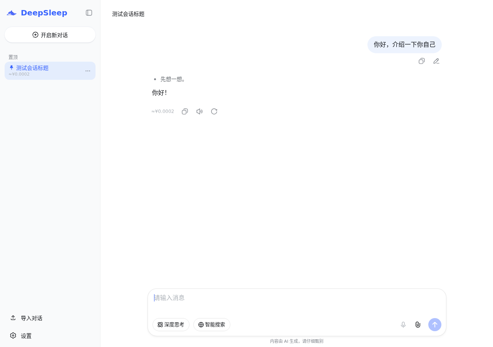
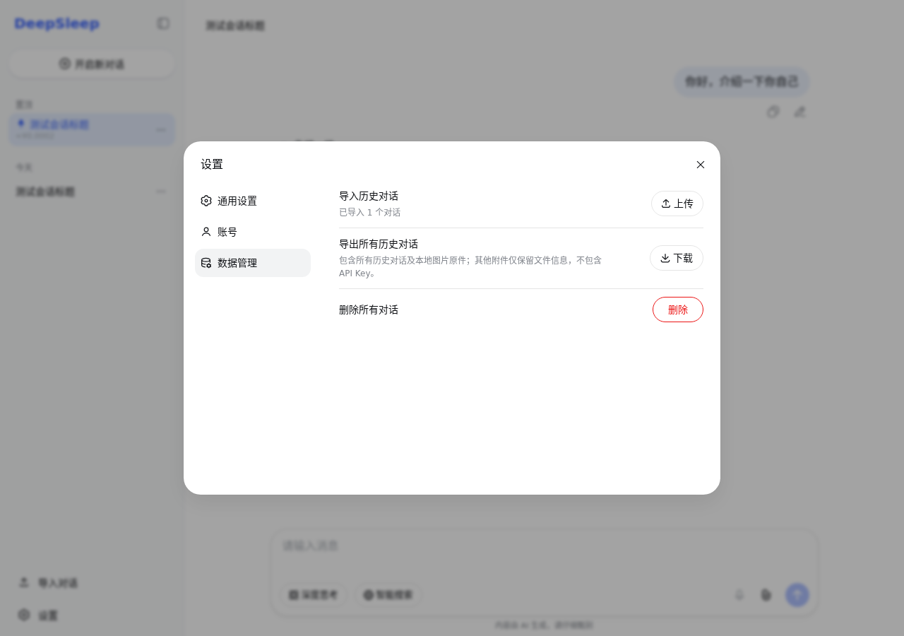

# DeepSleep（自建 DeepSeek 网页版）

把 [DeepSeek 官方演示客户端 chat-demo](https://github.com/deepseek-ai/chat-demo) 改造成**多账号、多端共享、Docker 一键部署**的自建网页版，站点名为「DeepSleep」：

- 复刻网页端界面与能力：深度思考、智能搜索（联网 + 边想边搜）、阅读链接、文件/图片上传、语音输入、朗读回答、消息分支（编辑 / 重新生成 / 继续生成）、Markdown / 公式 / Mermaid、中英双语、深浅色主题、**ZIP 历史对话导入导出**
- **账号密码登录**，历史对话、附件原件都存在服务端，换设备登录同一账号即可看到全部历史
- **API Key 绑定在账号下**（服务端加密保存，浏览器永远拿不到明文），也支持「服务器一个 Key 给多人共用」
- **去掉了「模型内容安全」**：请求里不再携带 `safety_check`，服务端代理还会兜底删除该参数
- **费用可见**：每条回答下方显示本次估算费用，侧边栏每条对话显示累计费用（口径与官方计费一致，见[费用估算](#九费用估算口径)）
- **对话管理**：置顶 / 取消置顶、**点击标题就地重命名**、单条对话导出为 ZIP、侧边栏「导入对话」一键导入（默认追加，也可覆盖）
- 品牌标识：站点名「DeepSleep」，使用自定义的睡眠鲸鱼图标
- 全部运行在 Docker 里，宿主机只需要 Docker，不用装 Node / pnpm；**应用容器不向宿主机暴露端口，加入外部 docker 网络 `web-net`，由 nginx 反向代理访问 `http://deepseek-web:3080`**

> 数据默认落在 `./data`：SQLite（会话、账号、附件 BLOB、API Key 密文）+ 自动生成的 `app-secret`。备份 = 拷走这个目录。

## 界面预览

| 登录 | 对话（含思考、费用） | 账号与 API Key |
|---|---|---|
|  |  |  |

| 置顶 + 侧边栏费用 | 导入方式（追加 / 覆盖） |
|---|---|
|  |  |

| 侧边栏一键导入 | 点击标题就地重命名 |
|---|---|
|  |  |

截图来自容器内的自动化冒烟测试（mock 模型回复），更多截图见 [`docs/screenshots`](docs/screenshots)。

---

## 一、快速开始

```bash
# 1. 准备配置
cp .env.example .env
# 建议：APP_SECRET=随机 64 位 hex；DEFAULT_DEEPSEEK_API_KEY=sk-...（所有人共用的默认 Key）
# nginx 反代 HTTPS 时保持 COOKIE_SECURE=true、TRUST_PROXY=true

# 2. 创建与 nginx 共用的 docker 网络（只需一次），然后启动
docker network create web-net
docker compose up -d --build

# 3. 让 nginx 反代到容器：http://deepseek-web:3080
#    完整 nginx 示例见 deploy/nginx.conf.example（第 10 节）
#    浏览器访问你的域名 → 注册第一个账号
```

> 应用容器**不映射宿主机端口**，只监听容器网络内的 3080。需要本机临时调试时，取消 `docker-compose.yml` 里 `ports` 的注释（`127.0.0.1:3081:3080`）再 `docker compose up -d`。

### 部署到另一台服务器

```bash
# 本机：打包源码（只含 git 跟踪的文件，不含 data/、.env、node_modules）
git archive -o deepsleep-src.tar.gz HEAD
scp deepsleep-src.tar.gz .env user@server:/opt/deepsleep/

# 服务器：解包并启动
cd /opt/deepsleep
tar -xzf deepsleep-src.tar.gz
docker network create web-net          # 若已存在可跳过
docker compose up -d --build
# 然后按第 10 节把 nginx 反代到 http://deepseek-web:3080

# 可选：把现有账号/历史一起搬过去
# 本机：tar -czf data.tar.gz data && scp data.tar.gz user@server:/opt/deepsleep/
# 服务器：cd /opt/deepsleep && tar -xzf data.tar.gz
```

> 服务器只需要 Docker（能访问 docker hub / npm 源、能访问 `api.deepseek.com`）。`.env` 里的 `APP_SECRET` 要与旧数据保持一致，否则已绑定的 API Key 需要重新绑定。

### 国内网络加速

- **npm 依赖**：构建时默认使用国内 npmmirror（淘宝）源，无需额外配置；海外环境可在 `.env` 里改 `NPM_REGISTRY=https://registry.npmjs.org`。
- **基础镜像**：默认 `node:24-bookworm-slim`。Docker Hub 拉取慢时，二选一：
  1. 在 Docker Desktop / daemon 里配好 registry mirror（推荐，一次配置全局生效）；
  2. 在 `.env` 里指定国内镜像仓库的同名镜像，例如
     `NODE_IMAGE=docker.m.daocloud.io/library/node:24-bookworm-slim`（或公司/云厂商提供的镜像地址）。
- 依赖层使用了 BuildKit 缓存挂载，重复构建时不会再重新下载 npm 包。

查看状态与日志：

```bash
docker compose ps
docker compose logs -f
```

停止 / 升级：

```bash
docker compose down          # 停止（数据保留在 ./data）
docker compose up -d --build # 重新构建升级
```

服务器上对外开放前，建议放在 Nginx / Caddy 后面加 HTTPS，并把 `COOKIE_SECURE=true`、`TRUST_PROXY=true` 写进 `.env`。

---

## 二、API Key 的三种用法

| 方式 | 配置 | 说明 |
|---|---|---|
| 每人绑定自己的 Key | 不配 `DEFAULT_DEEPSEEK_API_KEY` | 登录后在 **设置 → 账号** 里粘贴自己的 Key；服务端先用 `/models` 校验，再用 AES-256-GCM 加密存库。只有密文，浏览器只拿到 `sk-****abcd` 掩码。 |
| 一个 Key 全站共用 | `.env` 里设 `DEFAULT_DEEPSEEK_API_KEY=sk-...` | 账号没有绑定自己的 Key 时自动使用服务器默认 Key。适合「一个人付费、几个人一起用」。 |
| 混合 | 以上都配 | 默认用服务器 Key；某个账号在设置里绑了自己的 Key，就优先用他自己的。 |

所有对 DeepSeek 的请求都经过后端代理（`/api/ds/*`），由服务端注入 Key 并转发；密钥不会出现在前端代码、localStorage 或浏览器网络请求里。

---

## 三、账号与注册

- 注册 / 登录：用户名 + 密码（密码用 scrypt 加盐哈希）
- 登录态：HttpOnly + SameSite=Lax Cookie，默认 30 天（`SESSION_DAYS`）
- 关闭注册：`ALLOW_REGISTRATION=false`（已有账号仍可登录）
- 邀请码：`REGISTER_INVITE_CODE=xxx`，只有知道邀请码的人能注册（适合只给熟人用）
- 修改密码：设置 → 账号 → 修改密码；改完其他设备上的登录态失效
- 退出登录：设置 → 账号 → 退出登录（会清空本机缓存的对话数据）

> 账号没有「管理员后台」。几个人的小圈子使用够用；如果被陌生人注册，建议直接设邀请码或关闭注册后重建容器。

---

## 四、多端共享与同步

- 会话列表、每条消息、消息分支、附件原件全部存在服务端
- 登录后自动拉取；页面**切回前台 / 重新获得焦点**时会刷新列表与当前会话（生成中或有未保存修改时跳过，避免覆盖本地状态）
- 同一个账号在手机、电脑上可同时登录，互不踢下线
- 冲突策略：同一条会话两端同时改，以最后一次保存为准（个人使用场景足够）

---

## 五、历史对话导入 / 导出（ZIP）

设置 → 数据管理：

- **导出所有历史对话**：下载 ZIP，包含全部会话，以及服务端存有的图片原件；其他附件只保留文件信息（不含 API Key）
- **导出单条对话**：左侧会话列表 →「⋯」→ 导出为 ZIP，只导出这一条（方便单独分享/备份）
- **导入历史对话**：选择 ZIP 后可选两种方式：
  - **追加到现有对话（默认）**：保留现有对话，把导入内容加进来；同一份文件重复导入也不会覆盖，冲突的会话 id 会自动换新
  - **覆盖现有对话**：清空当前账号的全部对话，替换为导入内容
  - 两种方式都支持本应用导出的 ZIP 和 **DeepSeek 网页端导出的历史对话 ZIP**（从免费版搬家用这个）
- 导入是原子的：全部校验通过才提交；失败只清空暂存区，原对话不受影响
- **从分享链接导入**：侧边栏底部「从分享链接导入」，粘贴 DeepSeek 官网的对话分享链接（`https://chat.deepseek.com/share/...`），导入为一条新对话并打开
  - 服务端代为请求官网公开的分享接口，不需要登录 DeepSeek；保留提问、回答、深度思考、搜索、打开的网页和引用角标
  - 图片由服务端下载官网提供的预览图（比原图略小，官网不对分享开放原图）；下载失败的图片只保留文件名，非图片附件只有文件名和大小
  - 标题用第一句提问；「AI 生成，仅供参考」提示条不导入

---

## 六、已实现 vs 未实现

| 网页端能力 | 状态 |
|---|---|
| 深度思考 / 智能搜索 / 阅读链接 / 引用角标 / 搜索卡片 | ✅（`deepseek-flash`，Anthropic 兼容 Messages API） |
| 文件、图片上传（PDF/Word/PPT/图片等，Files API） | ✅ |
| 朗读回答（TTS）、语音输入（ASR） | ✅ 通过后端代理 |
| 编辑消息、重新生成、继续生成、消息分支切换 | ✅ |
| 自动会话标题、重命名、删除 | ✅（标题支持点击就地重命名） |
| 会话置顶、单条对话导出、侧边栏一键导入 | ✅（本改造新增） |
| Markdown、代码高亮、KaTeX、Mermaid | ✅ |
| 中英双语、深浅色、移动端布局、位置信息 | ✅ |
| 账号密码登录、多端同步、账号级 API Key | ✅（本改造新增） |
| ZIP 导入导出（追加 / 覆盖）、DeepSeek 网页端历史迁移 | ✅ |
| 从 DeepSeek 官网分享链接导入对话 | ✅ |
| 每条对话 / 每轮回答的费用估算（可按官方价调整） | ✅ 估算值，仅供参考 |
| **模型内容安全（safety_check）** | ❌ 已按要求移除（服务端代理也会删除该参数） |
| 分享对话链接（公开 URL） | ❌ 未做；用单条对话导出 ZIP 替代 |
| 多用户实时协作、团队空间 | ❌ 未做；每个账号数据隔离 |

> 合规提醒：本项目面向自用/熟人小范围使用。若对外提供服务，请自行承担内容安全审核、大模型登记、AI 标识等义务（DeepSeek 文档中的「模型内容安全」指引已在本项目中移除）。

---

## 七、目录结构

```
.
├── Dockerfile               # 多阶段构建：pnpm 构建前端 → 安装后端依赖 → 运行时镜像
├── docker-compose.yml       # 生产用：应用容器（加入外部网络 web-net）+ ./data + 健康检查
├── docker-compose.test.yml  # 联调用：mock DeepSeek API，不产生真实费用
├── deploy/nginx.conf.example # nginx 反向代理示例（SSE / 上传 / HTTPS）
├── .env.example
├── web/                     # 前端（基于 deepseek-ai/chat-demo，MIT）
│   └── src/
│       ├── assets/                  # 站点图标（DeepSleep 睡眠鲸鱼）
│       ├── components/auth/         # 登录 / 注册页
│       ├── components/settings/     # 设置：通用 / 账号 / 数据管理（导入追加/覆盖）
│       ├── components/sider/        # 侧边栏：置顶、每条对话的费用
│       └── services/
│           ├── auth.ts              # 登录态、账号、API Key 绑定
│           ├── pricing.ts           # 费用估算（按官方计费口径）
│           ├── api/backend.ts       # 自建后端请求封装
│           └── chat/db.ts           # 会话/附件存储（改为走服务端 API）
├── server/                  # 后端（Node 24 + Express + node:sqlite，无原生依赖）
│   ├── index.js             # 应用组装、静态文件、启动
│   ├── auth.js              # 注册/登录/退出/改密（scrypt + Cookie 会话）
│   ├── account.js           # API Key 绑定（校验 + 加密存储）
│   ├── storage.js           # 会话/附件/置顶/导入暂存与追加接口
│   ├── share.js             # 代取 DeepSeek 官网分享内容与图片（分享链接导入）
│   ├── proxy.js             # DeepSeek API 反向代理（流式、注入 Key、删 safety_check）
│   ├── pricing.js           # 官价单价 + 高峰时段 + 会话用量汇总
│   ├── db.js                # SQLite 数据层
│   └── test/                # node:test 端到端测试 + mock 上游
└── tools/e2e/               # 可选：容器内 headless Chromium 冒烟测试 + 图标渲染脚本
```

---

## 八、数据备份与迁移

- 全部状态在 `./data`：
  - `data/app.db`（SQLite 主库，含账号、会话 JSON、附件 BLOB）
  - `data/app.db-wal` / `-shm`（WAL 文件）
  - `data/app-secret`（未配置 `APP_SECRET` 时自动生成的加密密钥）
- 备份：`docker compose stop && tar -czf backup.tar.gz data && docker compose start`
- 迁移到新机器：拷走 `data/` 目录 + `docker-compose.yml`（如果设置过 `.env`，一起拷走；**换了 `APP_SECRET` 会导致已绑定的 API Key 无法解密，需要重新绑定**）
- 容器入口会以 root 修正 `/data` 的属主后降权到 `node` 运行，Linux 上首次启动也不需要手动改目录权限

---

## 九、费用估算口径

单价与计费口径对齐 DeepSeek 官方文档（[模型 & 价格](https://api-docs.deepseek.com/zh-cn/quick_start/pricing)、[联网工具 · 用量与计费](https://api-docs.deepseek.com/zh-cn/guides/web_tools#billing)）：

| deepseek-flash（元 / 百万 token） | 空闲时段 | 高峰时段 |
|---|---|---|
| 输入（缓存未命中） | 1 | 2 |
| 输入（缓存命中） | 0.02 | 0.04 |
| 输出 | 4 | 8 |

- `deepseek-v4-pro`：输入缓存未命中 4.5 / 9，缓存命中 0.15 / 0.30，输出 13.5 / 27
- 联网搜索、图片搜索、网页抓取：**5 元 / 1000 次**（即 0.005 元 / 次）
- 高峰时段：北京时间周一至周五 9:00-12:00、14:00-18:00，其余（含周末）为空闲时段，高峰单价翻倍。法定节假日无法在本地判断，按工作日**近似**处理。

计算方式：

```
费用 = (未命中输入 token × 未命中价
      + 缓存命中输入 token × 命中价
      + 输出 token × 输出价) / 1,000,000 × 高峰倍数
      + 计费联网次数 × 0.005

计费联网次数 = tool_search（文字搜索）+ tool_image_search（图片搜索）+ tool_fetch（网页抓取）
```

两个容易搞错的点（已按官方文档处理）：

1. `usage.input_tokens` 是**未命中缓存**的输入，`cache_read_input_tokens` 才是命中缓存的输入，不能相加后按一个价算；`cache_creation_input_tokens` 目前恒为 0。
2. `server_tool_use.web_search_requests` / `web_fetch_requests` 只是响应里结果块的数量，**不是计费次数**；计费看 `tool_search` / `tool_image_search` / `tool_fetch`。

展示位置：

- 每条回答下方：这一轮的费用（按该回答的 `createdAt` 判断高峰/空闲）
- 左侧会话列表：这条对话的累计费用（服务端把每条消息的用量按高峰/空闲分桶汇总，前端用当前单价换算）
- 设置 → 账号：**当前账号全部对话的累计花费**（服务端汇总所有会话的用量，统一按 deepseek-flash 单价估算）

不包含：TTS、ASR、文件解析 / OCR 的费用，以及官方可能给出的折扣、赠送余额、模型映射等差异。所以是**估算值，仅供参考，以 DeepSeek 账单为准**。

需要改单价时用 `PRICING_JSON` 覆盖（会与默认值合并），例如关闭高峰翻倍、或按自己的实际结算价调整：

```bash
# docker-compose.yml 的 environment 里加：
PRICING_JSON={"peakMultiplier":1}
# 或者只改某个模型价格：
PRICING_JSON={"models":{"deepseek-flash":{"inputCacheHit":0.02,"inputCacheMiss":1,"output":4}}}
```

---

## 十、Nginx 反向代理（默认访问方式）

应用容器**不向宿主机暴露端口**，只加入外部 docker 网络 `web-net`，在容器内监听 `3080`；nginx（容器）通过 `http://deepseek-web:3080` 访问它，并把你的域名反代过来。

### 1. 准备共享网络

```bash
docker network create web-net    # 只需一次
```

nginx 容器也要加入这个网络（`external: true`）：

```yaml
services:
  nginx:
    image: nginx:stable
    networks:
      - web-net
networks:
  web-net:
    external: true
```

### 2. 反代配置

完整示例见 [`deploy/nginx.conf.example`](deploy/nginx.conf.example)，关键点：

| 配置 | 原因 |
|---|---|
| `proxy_pass http://deepseek-web:3080;` | 容器名在 `web-net` 内可直接解析 |
| `proxy_buffering off;` + `proxy_cache off;` | 流式回答（SSE）必须不缓冲，否则一个字不流、最后一次性出现 |
| `proxy_read_timeout 3600s;` | 深度思考/长回答不要中途 504 |
| `proxy_request_buffering off;` | 大文件上传边收边转发，避免 nginx 先落盘再转 |
| `client_max_body_size 100m;` | 至少要 ≥ 应用的上传上限（默认 96MB） |
| `proxy_set_header X-Forwarded-Proto $scheme;` | 后端据此给 Cookie 加 Secure（`.env` 里 `COOKIE_SECURE=true`、`TRUST_PROXY=true`） |
| `proxy_set_header Host $host;` | **必须**：后端做同源校验（CSRF 防护）；nginx 默认会把 Host 改成上游地址，导致写请求返回 403「跨站请求被拒绝」 |
| `proxy_set_header X-Forwarded-Host $host;` | 可选：后端兼容 Host 被改写的情况，作为同源校验的兜底 |

### 3. 如果 nginx 跑在宿主机上（不是容器）

宿主机 nginx 无法直接解析 `web-net` 里的容器名，需要临时把端口映射出来：

```yaml
# docker-compose.yml
ports:
  - "127.0.0.1:3081:3080"   # 只监听本机，再由宿主机 nginx 反代 http://127.0.0.1:3081
```

### 4. HTTPS

证书由你的 nginx 负责（certbot / 云厂商托管证书均可）。跑在 HTTPS 后面时请在 `.env` 里保持：

```bash
COOKIE_SECURE=true
TRUST_PROXY=true
```

### 5. 常见问题

| 现象 | 原因 / 处理 |
|---|---|
| 写操作（登录/注册/发送）返回 `403 {"error":{"message":"跨站请求被拒绝"}}` | nginx 没保留原始 Host（默认会改成 `deepseek-web:3080`），与浏览器 `Origin` 不一致。加 `proxy_set_header Host $host;`；后端日志会打印 `[same-origin]` 一行说明两边 host 分别是什么 |
| 流式回答不流式、最后整段出现 | 缺 `proxy_buffering off;`（以及 `proxy_cache off;`） |
| 上传大文件 413 / 卡住 | nginx 加 `client_max_body_size 100m;` 和 `proxy_request_buffering off;` |
| 登录后立刻变未登录 | `COOKIE_SECURE=true` 但实际是 http 访问；或 nginx 没传 `X-Forwarded-Proto` |

---

## 十一、开发与测试（同样全部在 Docker 内）

> 不需要在宿主机安装 Node、pnpm 或任何依赖。

```bash
# 后端端到端测试（mock DeepSeek API，不花钱）
docker build --target test -t deepseek-web-test .
docker run --rm deepseek-web-test

# 前端类型检查 / Lint（在镜像的构建阶段容器里跑）
docker build --target web -t dsw-web .
docker run --rm dsw-web pnpm type
docker run --rm dsw-web pnpm lint

# 本地联调：mock 上游 + 完整应用
docker compose -f docker-compose.test.yml up -d --build

# 可选：浏览器冒烟测试（并截图到 docs/screenshots）
docker build -t dsw-e2e tools/e2e
docker run --rm --network dpsk-self_default \
  -e TARGET_URL=http://deepseek-web-test:3080 \
  -v "$PWD/docs/screenshots:/shots" dsw-e2e

# 可选：重新生成 apple-touch-icon.png（SVG → PNG）
docker run --rm -v "$PWD/web/src/assets:/out" dsw-e2e \
  node render-icon.mjs /out/favicon.svg /out/apple-touch-icon.png 180
```

宿主机一个 Node / pnpm / Chromium 都不用装：上面这些命令只是调用 Docker。

### 已通过的验证

- 后端：**13 项** `node:test` 端到端测试（注册登录、改密、跨账号隔离、会话 CRUD、置顶排序、附件上传下载与回收、导入原子替换、**追加导入与 id 冲突换新**、API Key 加密绑定、SSE 透传、`safety_check` 被删除、默认 Key 回落、CSRF 拦截）
- 前端：`tsc` 类型检查 + `oxlint` 零告警
- 浏览器（headless Chromium）：**35 项**检查全部通过——注册进入对话、流式回答、思考块、消息与侧边栏费用、置顶、**会话菜单定位**、刷新后历史恢复、单条对话导出 ZIP、绑定 Key 后刷新仍生效、**追加导入 / 覆盖导入 / 侧边栏一键导入**、导出全部对话、退出重登、**点击标题重命名**、控制台零报错

> 注意：`server/test/mock-server.mjs` 是常驻 mock 服务，测试命令已显式指定 `test/e2e.test.js`，避免 `node --test` 把它当测试文件加载导致进程不退出。

前端单独热更新（可选，仅开发时）：`docker compose` 里跑后端后，在 `web/` 目录用容器的 Node 跑 `pnpm dev`（`rspack serve` 监听 8090，并把 `/api` 代理到 3080）。日常使用不需要这一步。

---

## 十二、配置项

| 环境变量 | 默认值 | 说明 |
|---|---|---|
| `PORT` | `3080` | 容器内监听端口（保持 3080，由 nginx 反代） |
| `DATA_DIR` | `/data` | 数据目录 |
| `DEEPSEEK_API_BASE` | `https://api.deepseek.com` | 上游地址；测试时指向 mock |
| `DEFAULT_DEEPSEEK_API_KEY` | 空 | 服务器默认 Key（账号未绑定时使用） |
| `APP_SECRET` | 自动生成 | 加密 API Key 用；生产建议显式设置并妥善保存 |
| `ALLOW_REGISTRATION` | `true` | 是否允许注册 |
| `REGISTER_INVITE_CODE` | 空 | 非空时注册必须填写 |
| `SESSION_DAYS` | `30` | 登录态有效天数 |
| `COOKIE_SECURE` | `true`（compose 默认） | nginx 反代 HTTPS 时保持 `true` |
| `TRUST_PROXY` | `true`（compose 默认） | 在 nginx 后面时保持 `true`（取真实 IP、识别 X-Forwarded-Proto） |
| `MAX_JSON_BYTES` | 48MB | 单条会话 JSON 上限 |
| `MAX_UPLOAD_BYTES` | 96MB | 单个附件原件上限 |
| `PRICING_JSON` | 官方价 | 覆盖费用估算单价，见[费用估算口径](#九费用估算口径) |
| `LOG_REQUESTS` | 空 | 设为 `1` 时打印每个 API 请求的耗时/大小，排查上传或代理慢 |
| `TZ` | `Asia/Shanghai` | 时区（高峰时段判断按北京时间，与容器时区无关） |
| `NPM_REGISTRY` | `https://registry.npmmirror.com` | 构建时 npm 源（仅构建阶段生效） |
| `NODE_IMAGE` | `node:24-bookworm-slim` | 构建用基础镜像，可替换为国内镜像仓库地址 |

---

## 十三、附件上传与上下文管理

### 附件上传流程

一次附件上传有两段，都经过 nginx 反向代理（浏览器 → 你的域名/nginx → 应用容器）：

1. **给模型用**：选中文件时立刻上传到 DeepSeek Files API（`/api/ds/anthropic/v1/files`，由后端代理，multipart 流式转发）。PDF/Word/PPT 会触发服务端版面解析，本身耗时。
2. **给多端预览用**：把原件存进你服务器的 SQLite（图片缩略图、跨设备打开靠它）。

优化点：

- 第 2 段改为**选中文件时就与第 1 段并行上传**（`web/src/services/chat/drafts.ts`），并按附件 id 去重（`web/src/services/chat/db.ts` 的 `storedIds`），发送时不再串行叠加一次上传。
- **非图片原件超过 8MB 不再存第二份**（历史里已有 DeepSeek `file_id`，跨设备只影响「打开原件」，不影响提问），避免大 PDF/PPT 把带宽占满。
- 排查慢在哪：`.env` 里设 `LOG_REQUESTS=1`，然后 `docker compose logs -f deepseek-web`，可以看到每个请求的耗时和大小（例如 Files API 代理 vs 本地原件的时间占比）。

> 提示：nginx 侧务必按 [`deploy/nginx.conf.example`](deploy/nginx.conf.example) 配置 `proxy_request_buffering off;` 和足够大的 `client_max_body_size`，否则大文件上传会先在 nginx 落盘或直接 413；服务器上行带宽也会影响上传速度。

### 上下文管理

每轮请求由前端重新组装**当前分支的完整历史**，规则：

- 只保留「用户提问 + 有有效回答」成对的轮次；报错、停止、空回答、拒答的轮次不进上下文
- 历史思考不回传，只回传回答正文；相邻文本合并，引用标记去掉
- 历史联网搜索结果/打开网页块不回传；只有「阅读链接」的调用+结果带 `signature` 原样回传（服务端还原网页正文）
- 附件按 `file_id` 引用（图片 `image` 块 / 文档 `document` 块）；没有 `file_id` 又没有本地原件的附件会跳过
- 继续生成时把最后一条回答作为 assistant 前缀（含思考签名）
- 日期/位置等用户元信息变化时以 `latest_reminder` 插入
- 没有本地截断/摘要：依赖模型 1M 上下文，超限会返回 400；如有需要可以加「按 token 预算丢弃最早轮次」策略

---

## 十四、来源与许可

- 前端基于 [deepseek-ai/chat-demo](https://github.com/deepseek-ai/chat-demo)（MIT License），保留了其 `LICENSE` 与界面代码，改造了登录、存储、代理与设置部分；图标为项目自定义的 DeepSleep 睡眠鲸鱼图。
- 界面协议说明见 [DeepSeek API 文档 · 构建 Chatbot](https://api-docs.deepseek.com/zh-cn/guides/build_a_chatbot)，价格页见 [模型 & 价格](https://api-docs.deepseek.com/zh-cn/quick_start/pricing)。
- 本项目同样以 MIT License 提供，按「自用/小范围使用」设计，请遵守 DeepSeek 开放平台服务协议。
